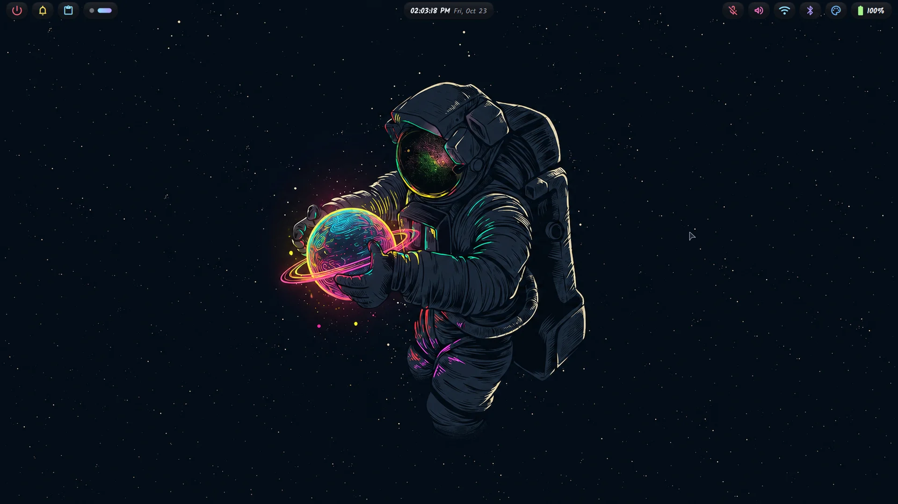
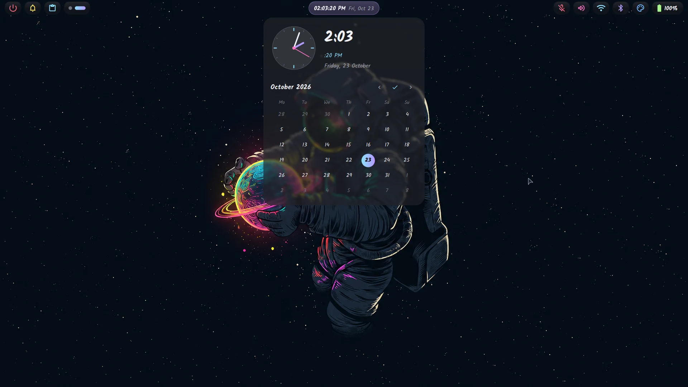
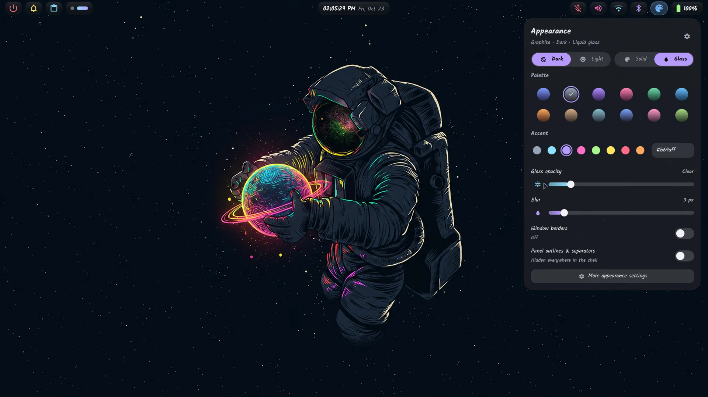
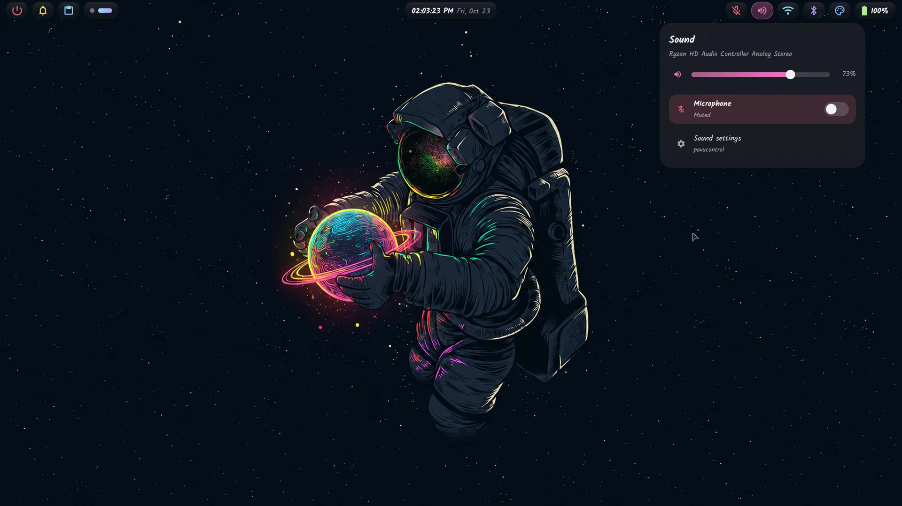
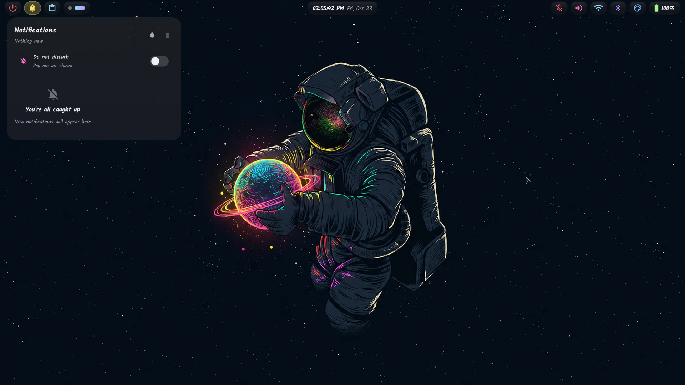
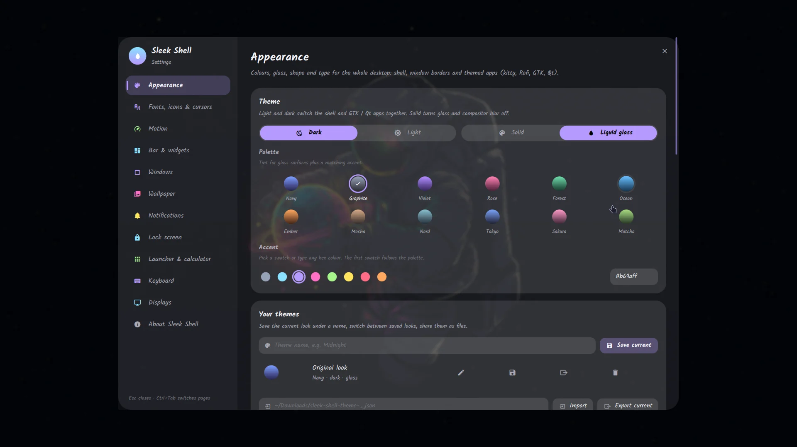
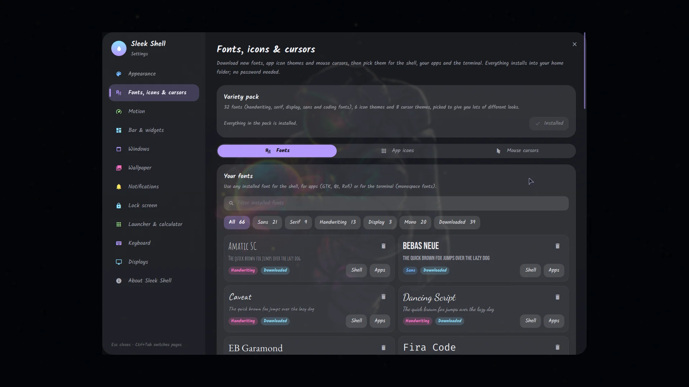
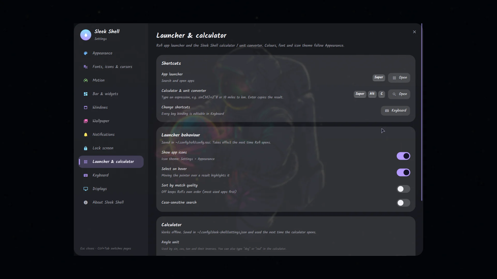
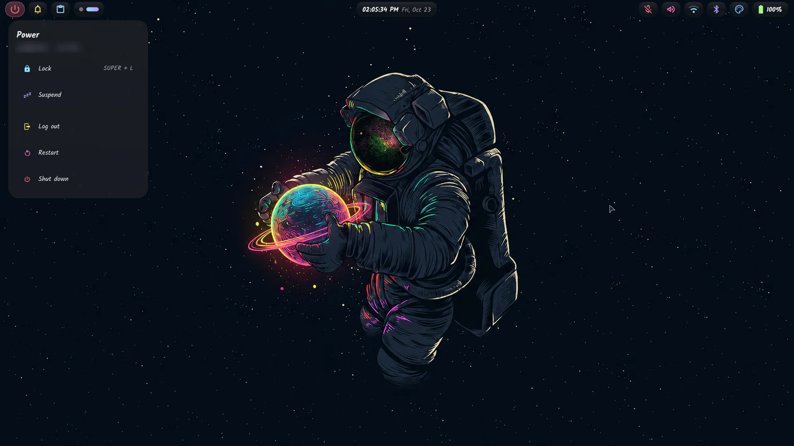

# Sleek Shell

A complete desktop shell for [Hyprland](https://hypr.land) built with [Quickshell](https://quickshell.org):
bar, dropdown panels, notifications, lock screen, workspace overview, app switcher, a settings app
that themes your whole desktop, an offline calculator for rofi, and an optional greetd login screen.



| | |
|---|---|
|  |  |
|  |  |
|  |  |
|  |  |

## Status

Version 0.1.0, the first public release. It is developed and used daily on Arch-based systems (CachyOS).
Other distributions are **experimental**: their package names and detection are covered by fixture tests,
but nobody has run Sleek Shell on them yet. See [docs/DISTROS.md](docs/DISTROS.md).

| Needs | Version |
|---|---|
| Hyprland, with the Lua config | 0.55 or newer (tested on 0.56.2) |
| Quickshell | 0.2 or newer (tested on 0.3.2) |
| rofi, with Wayland support | 2.0 or newer |
| systemd | for the power menu and the greeter |

## Features

- **Bar** on every monitor: workspaces per monitor, clock, notifications, clipboard, sound, Wi-Fi,
  Bluetooth, battery, and power. You can reorder and hide widgets. A centre island shows the volume and brightness OSD and what is playing.
- **Panels**: notifications (with do-not-disturb), clipboard history (text and images), calendar, sound
  (choose the output device), Wi-Fi, Bluetooth, battery and brightness with power profiles, and a power menu.
- **Lock screen** (`SUPER+L`): blurred wallpaper with a glass card. It authenticates through PAM.
- **Workspace overview** (`SUPER+Tab`), **app switcher** (`ALT+Tab`), and **minimise** (`SUPER+H`).
- **Settings app** (`SUPER+I`) with these pages:
  - **Appearance**: 12 palettes, accent, glass/solid, blur, borders, light/dark.
  - **Fonts, icons & cursors**: can download them.
  - **Motion**, **Bar**, **Windows**, **Wallpaper** (awww), **Notifications**, **Lock screen**, **Launcher**.
  - **Keyboard**: rebind or disable any shortcut without editing a file.
  - **Displays**: arrange monitors, with a 15-second revert.
- **App theming**: the shell palette is applied to kitty, rofi, GTK 3/4, Qt/KDE, and micro. You can turn this off
  per app in Settings.
- **Calculator & unit converter** (`SUPER+ALT+C`): runs inside rofi, offline, and never calls `eval`.
- **Login greeter** (optional, separate, needs root): greetd, Hyprland, and Quickshell, in the same look.

## Install

```sh
git clone https://github.com/mvjishnu/sleek-shell.git && cd sleek-shell
./install.sh --check      # what is missing on this system (installs nothing)
./install.sh --dry-run    # exactly what would be copied and backed up
./install.sh              # install for your user
```

The installer is per-user. It never uses `sudo`, never installs packages, and never touches `/etc`.
It backs up everything it replaces and records every file in a manifest, so you can undo it with
`~/.local/share/sleek-shell/uninstall.sh`. If you already have a Hyprland config, it is **kept** unless you pass
`--replace-hypr`. Full guide: [docs/INSTALL.md](docs/INSTALL.md).

## Documentation

| | |
|---|---|
| [INSTALL](docs/INSTALL.md) | dependencies, profiles, what goes where, upgrades |
| [UNINSTALL](docs/UNINSTALL.md) | removing Sleek Shell and restoring your old files |
| [CONFIG](docs/CONFIG.md) | settings files, `user.lua`, environment variables, using your own Hyprland config |
| [KEYBINDS](docs/KEYBINDS.md) | every default shortcut |
| [GREETER](docs/GREETER.md) | the optional greetd login screen |
| [DISTROS](docs/DISTROS.md) | per-distribution notes and package names |
| [TROUBLESHOOTING](docs/TROUBLESHOOTING.md) | common problems and logs |
| [ARCHITECTURE](docs/ARCHITECTURE.md) | how the pieces fit together |
| [QUICKSHELL](docs/QUICKSHELL.md), [LOCKSCREEN](docs/LOCKSCREEN.md) | shell internals |

## License

MIT, see [LICENSE](LICENSE). The bundled Material Symbols font is Apache-2.0
([assets/fonts/LICENSE-MaterialSymbols.txt](assets/fonts/LICENSE-MaterialSymbols.txt)). The bundled wallpaper is
MIT ([assets/wallpapers/LICENSE.md](assets/wallpapers/LICENSE.md)).
